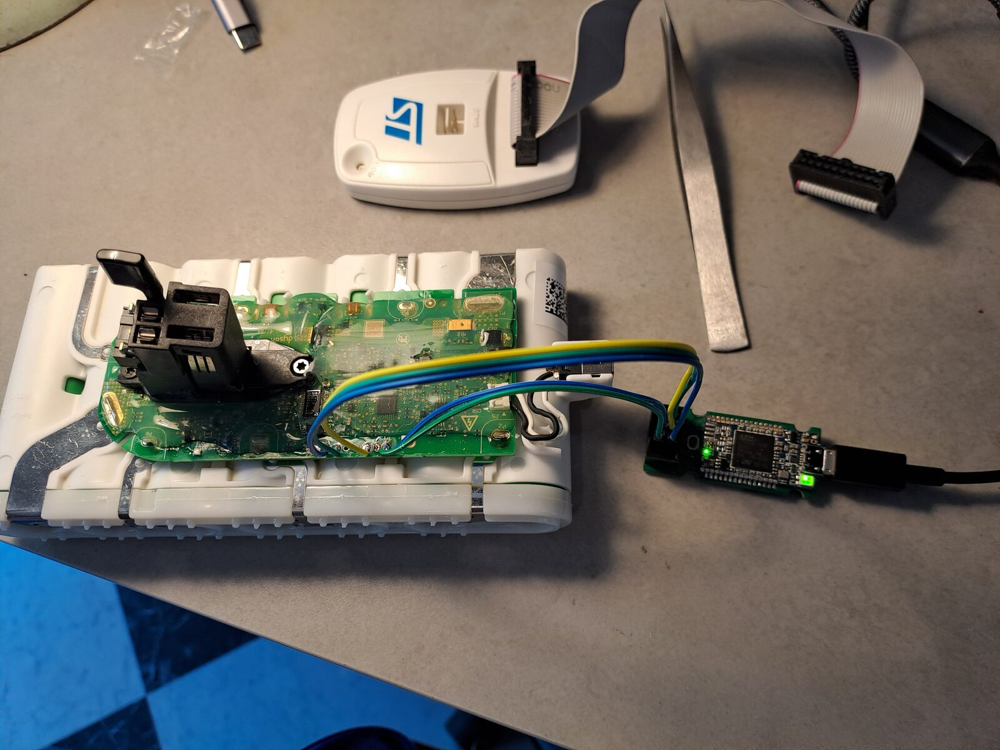
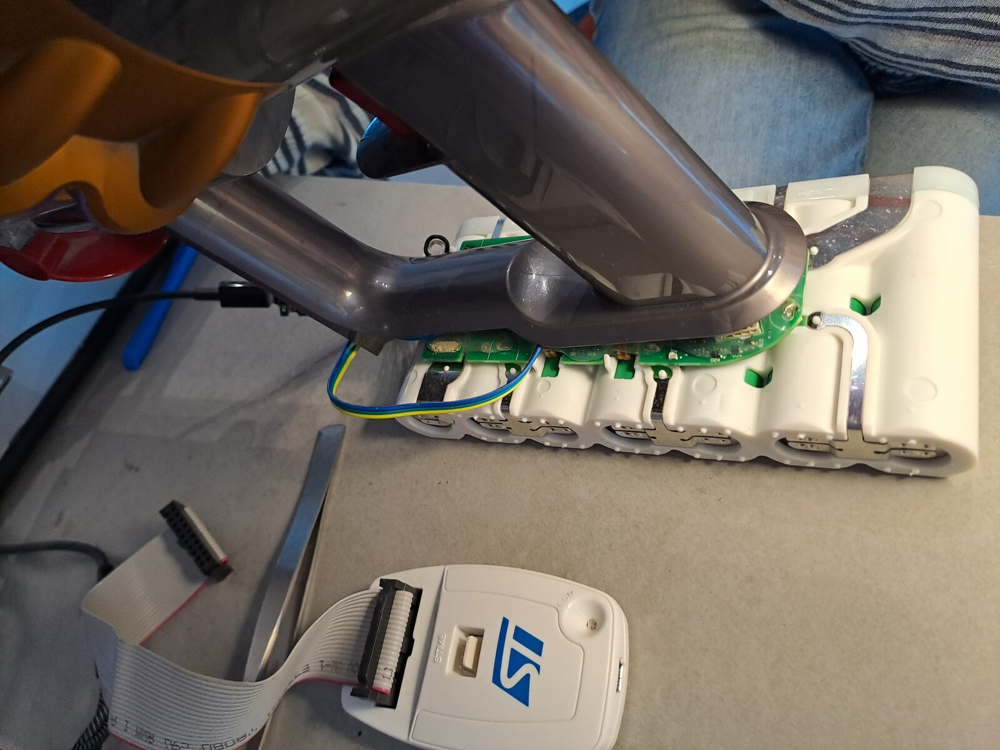
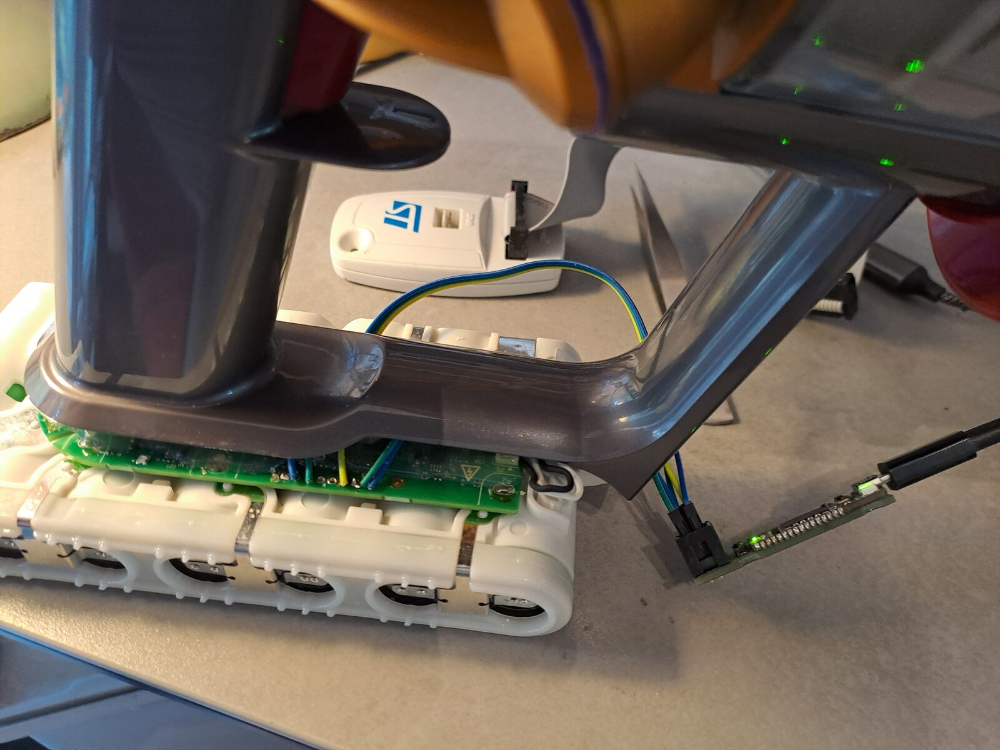

# Reviving a locked Dyson V15 pack (SV22)

A field report: one V15 pack that went dead, how the cause was found on the
stock firmware's own debug output, and how this firmware was put on it with a
Black Magic Probe. It follows the main README; read its warnings first.



## Symptom

The pack did nothing at all: no LEDs, no motor, no charging. No sign of heat,
board intact, 28.10 V across the pack. Cell voltages, measured from one end:

| 1 | 2 | 3 | 4 | 5 | 6 | 7 |
|---|---|---|---|---|---|---|
| 4.059 | 4.061 | **3.855** | 4.007 | 4.061 | 4.023 | 4.075 |

One cell about 190 mV below the others, at roughly 85 % charge.

## Diagnosis: the stock firmware's lockout

The stock firmware prints a log on the programming header's UART (PA10,
115200 8N1, 3.3 V) - but only at boot. Pressing the trigger or docking the
pack while it is locked prints nothing. Resetting the MCU (pulling RST low)
does: [logs/stock-firmware-lockout.txt](logs/stock-firmware-lockout.txt).

```
0248JB.00.03.002.0008
release - 35fbc15
SAMD20E15 Rev G
***Lockout - CellImbal***
...
ChargeMaint  L:CellImbal  V: 4.173 4.074 4.090 4.073 3.922 4.087 4.081
Locked       R:Lockout
```

- The firmware numbers cells from the other end, so its cell 5 is cell 3 in
  the table above.
- Its history shows that cell trailing the others by 150-190 mV on every
  logged cycle, and 240-250 mV at the end of charge. Charging stops when the
  highest cell reaches 4.20 V, so the weak one never filled, and nothing
  balanced it. The lockout fired at a 251 mV spread at the end of a charge.
- The lockout is stored in flash. It survives resets and power cycles, and no
  user-accessible way out is known. The cells themselves were fine.
- The same log also shows a full discharge at about 35 A with the pack at
  69-71 °C (boost mode).

## Fixing the cell first

Flashing does not fix a weak cell. Before flashing, the low cell was charged
on its own from a bench supply: constant voltage at the level of the other
cells (4.05 V), current limited to 0.5 A, with the probe unplugged from the
host so the supply's ground and the host's ground could not meet through the
cell string. It ended at 4.051 V.

The new firmware's first boot read the pack with a 65 mV spread, which the
balancer handles on the dock:
[logs/first-boot.txt](logs/first-boot.txt).

```
Dyson V11/V15 BMS After market firmware 24e0167+
V: 4074 4024 4059 4009 4042 4056 4049 mV P: 28313 mV (cached)
TEMP(boot) PA07=19.4 PA08=20.7 'C  CHG_FB=1674
```

To find out whether a cell leaks rather than simply drifted, rest the pack
for 48-72 hours and measure again: a leaking cell loses noticeably more than
the others. This firmware now also watches for it - see "Weak cell detection"
in the main README.

## Wiring

Programming header, a row of eight pads, board seen from the top with the
square pad on the left:

```
  ■      ●      ●      ●      ●      ●       ●       ●
  1      2      3      4      5      6       7       8
 3.3V   GND    TX      ?      ?    SWCLK   SWDIO    RST
              PA10
```

| Pad | Probe |
|---|---|
| 1 3.3V | **nothing** - the pack makes its own 3.3 V; never feed it |
| 2 GND | GND |
| 3 TX (PA10) | UART RX, through a 1 kΩ series resistor |
| 6 SWCLK | SWCLK |
| 7 SWDIO | SWDIO |
| 8 RST | NRST |

- Check before connecting, with the pack awake: about 3.3 V between pads 1
  and 2, and pad 2 continuous with the pack negative. If not, the order
  differs on your board: stop.
- The 1 kΩ resistor makes it safe to try both of the probe's UART pins when
  its RX/TX naming is unclear: output against output stays below 3.3 mA.
- Leave the debugger unplugged once done. A connected SWD line keeps the pack
  from sleeping properly (`BMS:DEBUGGER_SEEN` in the log).

The probe used here is an STLINK-V3MINI reflashed with Black Magic Probe
firmware (v2.0.0-318). Its second serial port is the UART, so one probe does
both jobs.




The vacuum can be mounted on the opened pack with the wires in place, which
is how the stock firmware's log was captured.

## Flashing with a Black Magic Probe

The erase is the point of no return: it removes the Dyson firmware, which
cannot be read out first while the security bit is set.

1. **Check the target** (read only). Wake the pack (trigger, or a short pulse
   on RST) just before.

   ```
   arm-none-eabi-gdb -nx --batch \
     -ex 'target extended-remote /dev/cu.usbmodemXXXX1' -ex 'monitor swdp_scan'
   ```

   Expect `Atmel SAMD20E15A (rev G) protected`.

2. **Erase.** GDB 13 asserts in `inferior_thread` right after `attach 1` on a
   protected SAMD20, so `monitor erase_mass` never runs. Send the packets
   directly instead:

   ```
   python3 -I tools/bmp_rsp.py /dev/cu.usbmodemXXXX1 \
     mon:swdp_scan attach:1 mon:erase_mass detach
   ```

   Here the erase completed but the probe stopped answering until it was
   unplugged and plugged back in. Scan again afterwards: the target must no
   longer say `protected`.

3. **Program and verify.** Build first (main README), then:

   ```
   arm-none-eabi-gdb -nx --batch \
     -ex 'target extended-remote /dev/cu.usbmodemXXXX1' \
     -ex 'monitor swdp_scan' -ex 'attach 1' \
     -ex 'load' -ex 'compare-sections' -ex 'detach' \
     V11_BMS/build/samd20_firmware.elf
   ```

   Every section must report `matched`.

4. **Reset.** `detach` resumes the core where it was halted before `load` -
   somewhere in erased flash - and it ends up in `Dummy_Handler` with no UART
   output. Reset it once (or pulse RST):

   ```
   arm-none-eabi-gdb -nx --batch \
     -ex 'set mem inaccessible-by-default off' \
     -ex 'target extended-remote /dev/cu.usbmodemXXXX1' \
     -ex 'monitor swdp_scan' -ex 'attach 1' \
     -ex 'set *(unsigned int *)0xE000ED0C = 0x05FA0004' -ex 'detach'
   ```

   The boot banner then appears on the UART.

## Status

| Check | Result |
|---|---|
| Erase and programming, `compare-sections` | OK |
| Boot, seven cells, pack voltage, both temperature sensors | OK |
| Sleep when idle | OK |
| Trigger mode 3 and weak-cell detection, host tests | OK (`tests/host_regressions.py`) |
| Motor, trigger gestures, charging on the vacuum | not yet reported |
